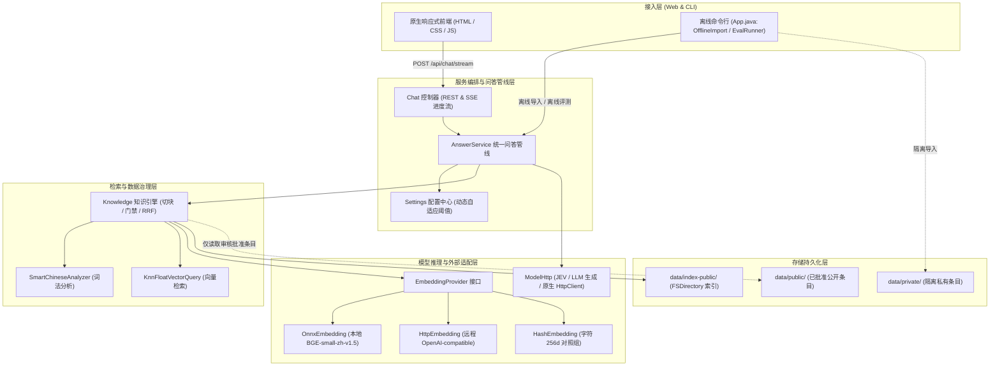
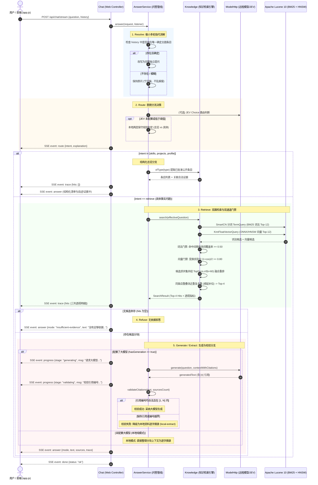

# 个人数字分身 · 架构设计与代码导读 (ARCHITECTURE)

本文档面向系统设计者、维护者以及技术面试官，旨在深度解析**个人数字分身 RAG 系统**的模块职责划分、端到端请求生命周期、核心设计决策与工程权衡，并提供一份循序渐进的代码研读路线。

---

## 1. 架构总览与分层设计

本项目基于 **JDK 25** + **Spring Boot 3.5.16** + **Apache Lucene 10.3.1** 构建，采用严格的**单进程、单索引引擎、零外部中间件强依赖**架构：

---

## 2. 模块地图 (Module Map)

代码组织结构平铺于 `local.digital` 包下，共 13 个核心类文件，职责划分高度内聚：

### 2.1 基础模型与配置中心
- [`Entry`](file:///home/hatch/workspace/projects/clone-yourself-rag-jev/src/main/java/local/digital/Entry.java)
  - **职责**：公开与私有条目的不可变领域实体模型（Java Record）。
  - **为什么存在**：集中承载卡片核心字段（`id`, `type`, `title`, `content`, `level`, `boundaries`, `evidenceIds`, `visibility`, `publicConfirmed`, `source`, `updatedAt`）。通过 [`approved()`](file:///home/hatch/workspace/projects/clone-yourself-rag-jev/src/main/java/local/digital/Entry.java#L8) 实现公开批准的强制判定规则；在进入任何检索或大模型上下文前由 [`validate()`](file:///home/hatch/workspace/projects/clone-yourself-rag-jev/src/main/java/local/digital/Entry.java#L13) 校验数据完备性与长度边界。
- [`Settings`](file:///home/hatch/workspace/projects/clone-yourself-rag-jev/src/main/java/local/digital/Settings.java)
  - **职责**：全局动态配置提供者，封装 Spring `Environment`。
  - **为什么存在**：统一管理所有 `app.*` 属性与环境变量映射。对外暴露带默认值与范围钳位的类型安全方法（如 [`timeout()`](file:///home/hatch/workspace/projects/clone-yourself-rag-jev/src/main/java/local/digital/Settings.java#L11)、[`lexicalCoverage()`](file:///home/hatch/workspace/projects/clone-yourself-rag-jev/src/main/java/local/digital/Settings.java#L21)、[`vectorThreshold()`](file:///home/hatch/workspace/projects/clone-yourself-rag-jev/src/main/java/local/digital/Settings.java#L26)），提供测试时轻量 mock 的 [`withDisabledGeneration()`](file:///home/hatch/workspace/projects/clone-yourself-rag-jev/src/main/java/local/digital/Settings.java#L31)。

### 2.2 语义嵌入抽象与多模式实现
- [`EmbeddingProvider`](file:///home/hatch/workspace/projects/clone-yourself-rag-jev/src/main/java/local/digital/EmbeddingProvider.java)
  - **职责**：向量嵌入模型顶层契约接口，继承 `AutoCloseable`。
  - **为什么存在**：解耦向量化实现与索引/检索管线。区分文档侧 [`embedDocument(String)`](file:///home/hatch/workspace/projects/clone-yourself-rag-jev/src/main/java/local/digital/EmbeddingProvider.java#L4) 与查询侧 [`embedQuery(String)`](file:///home/hatch/workspace/projects/clone-yourself-rag-jev/src/main/java/local/digital/EmbeddingProvider.java#L5)，使模型指令前缀仅施加于检索提问侧，文档入库不加。
- [`OnnxEmbedding`](file:///home/hatch/workspace/projects/clone-yourself-rag-jev/src/main/java/local/digital/OnnxEmbedding.java)
  - **职责**：基于 Microsoft ONNX Runtime 的本地神经语义嵌入实现（加载 BGE-small-zh-v1.5，512 维）。
  - **为什么存在**：支撑系统的完全离线与零依赖运行能力。包含内置轻量级 [`Tokenizer`](file:///home/hatch/workspace/projects/clone-yourself-rag-jev/src/main/java/local/digital/OnnxEmbedding.java#L19-L154)（实现 WordPiece 贪心最长匹配分词与字符偏移定位 [`TokenSpan`](file:///home/hatch/workspace/projects/clone-yourself-rag-jev/src/main/java/local/digital/OnnxEmbedding.java#L17)）。采用 **CLS pooling**（首 token 隐藏态提取）与 L2 归一化；在初始化阶段精细区分文件缺失、`LinkageError`（原生动态库未就绪）与 `OrtException`，不吞没致命错误。
- [`HttpEmbedding`](file:///home/hatch/workspace/projects/clone-yourself-rag-jev/src/main/java/local/digital/HttpEmbedding.java)
  - **职责**：OpenAI 兼容规范的远程向量化适配器。
  - **为什么存在**：满足商业级高维远程 Embedding（如 `bge-m3`、`text-embedding-3-small`）接入诉求，支持在启动阶段探测实际向量维度并校验单运行期维度恒定。
- [`HashEmbedding`](file:///home/hatch/workspace/projects/clone-yourself-rag-jev/src/main/java/local/digital/HashEmbedding.java)
  - **职责**：256 维字符级二元特征哈希向量实现。
  - **为什么存在**：仅作为基准评测对照组存在（在 `eval/CALIBRATION.md` 中量化比对语义模型与字面哈希差异），不再充当系统默认回退，避免假向量冒充语义理解。

### 2.3 检索存储与双通道知识引擎
- [`Knowledge`](file:///home/hatch/workspace/projects/clone-yourself-rag-jev/src/main/java/local/digital/Knowledge.java)
  - **职责**：知识存储、分块、Lucene 混合索引管理与双通道门禁检索核心。
  - **为什么存在**：
    1. **数据准入过滤**：在读取 `data/public/` 与内置条目时，强制校验 [`Entry.approved()`](file:///home/hatch/workspace/projects/clone-yourself-rag-jev/src/main/java/local/digital/Entry.java#L8)，排重并冻结条目列表。
    2. **Token 感知分块**：[`chunkEntry()`](file:///home/hatch/workspace/projects/clone-yourself-rag-jev/src/main/java/local/digital/Knowledge.java#L188) 按分词器 token 预算计长（单块 $\le 400$ tokens，含标题与特殊 token 预留，重叠 64 tokens），精准记录 [`Chunk`](file:///home/hatch/workspace/projects/clone-yourself-rag-jev/src/main/java/local/digital/Knowledge.java#L397) 的字符起止偏移。
    3. **Lucene 混合索引**：单 `IndexWriter` 写入 `TextField`（BM25 词法）与 `KnnFloatVectorField`（HNSW 向量）。
    4. **双通道门禁与融合**：[`searchWithCandidates()`](file:///home/hatch/workspace/projects/clone-yourself-rag-jev/src/main/java/local/digital/Knowledge.java#L244) 并行执行 SmartCN BM25 词法召回（Top-12）与 Knn 向量召回（Top-12）；施加词法覆盖率门禁（$\ge 0.50$）与向量变换余弦门禁（ONNX $\ge 0.80$）；通过 `TopDocs.rrf(k=60)` 重排并执行同条目字符重叠去重，输出携带详尽透视指标的 [`Hit`](file:///home/hatch/workspace/projects/clone-yourself-rag-jev/src/main/java/local/digital/Knowledge.java#L398) 与 [`SearchResult`](file:///home/hatch/workspace/projects/clone-yourself-rag-jev/src/main/java/local/digital/Knowledge.java#L425)。
- [`OfflineImport`](file:///home/hatch/workspace/projects/clone-yourself-rag-jev/src/main/java/local/digital/OfflineImport.java)
  - **职责**：独立离线导入工具，完全不启动 Web 服务与网络连接。
  - **为什么存在**：安全解析本地 JSON、TXT、Markdown 及文本型 PDF（PDFBox 逐页提取定位），默认将数据封存于 `data/private/`；仅当命令行附带 `--app.approve-public=true` 且条目标注完备时方写入 `data/public/`。

### 2.4 网络通信与问答管线
- [`ModelHttp`](file:///home/hatch/workspace/projects/clone-yourself-rag-jev/src/main/java/local/digital/ModelHttp.java)
  - **职责**：基于 JDK 21+ 原生 `java.net.http.HttpClient` 的轻量外部服务适配器。
  - **为什么存在**：零第三方庞大 SDK 依赖完成 JEV 意图路由、大模型对话生成（带引用提示词约束）以及向量化调用。严格配置每请求超时，对 429、5xx 与格式异常执行脱敏，禁止向外泄露密钥或堆栈。
- [`AnswerService`](file:///home/hatch/workspace/projects/clone-yourself-rag-jev/src/main/java/local/digital/AnswerService.java)
  - **职责**：端到端统一问答管线服务（供 REST、SSE 与离线评测共享）。
  - **为什么存在**：集中封装多轮指代消解、路由判定、检索调度、结构化直答生成、大模型生成/摘录降级分支。实现全系统**唯一的引用编号合法性校验**（[`validateCitations()`](file:///home/hatch/workspace/projects/clone-yourself-rag-jev/src/main/java/local/digital/AnswerService.java#L272)），支持流式事件回调接口 [`AnswerListener`](file:///home/hatch/workspace/projects/clone-yourself-rag-jev/src/main/java/local/digital/AnswerService.java#L30-L38)。
- [`Chat`](file:///home/hatch/workspace/projects/clone-yourself-rag-jev/src/main/java/local/digital/Chat.java)
  - **职责**：Spring MVC 控制器与 HTTP 协议适配端点。
  - **为什么存在**：暴露应用状态探活 [`GET /api/status`](file:///home/hatch/workspace/projects/clone-yourself-rag-jev/src/main/java/local/digital/Chat.java#L39)、标准同步请求 [`POST /api/chat`](file:///home/hatch/workspace/projects/clone-yourself-rag-jev/src/main/java/local/digital/Chat.java#L50) 以及真实进度流 [`POST /api/chat/stream`](file:///home/hatch/workspace/projects/clone-yourself-rag-jev/src/main/java/local/digital/Chat.java#L69)。利用虚拟线程池驱动 `SseEmitter` 异步推流，保证客户端断开时的资源即时回收。
- [`EvalRunner`](file:///home/hatch/workspace/projects/clone-yourself-rag-jev/src/main/java/local/digital/EvalRunner.java)
  - **职责**：离线基准评测运行器。
  - **为什么存在**：非 Web 上下文下自动化运行评测集（`eval/dev.json` 与 `eval/test.json`），精准测量 Recall@4、Hit@4、MRR@4、路由准确率、假答率、误拒率及暖机延迟，自动输出时间戳与 `latest` 评测报告。
- [`App`](file:///home/hatch/workspace/projects/clone-yourself-rag-jev/src/main/java/local/digital/App.java)
  - **职责**：统一可执行主类入口。
  - **为什么存在**：依据入参分流执行 `OfflineImport`、`EvalRunner` 或标准 Spring Boot Web 启动。

---

## 3. 端到端请求生命周期剖析

下图清晰展示了一个提问进入系统后的完整处理时序：

### 3.1 详细处理阶段说明

1. **多轮指代消解 (Resolve)**  
   - 输入最近 10 轮历史（限制总字符 $\le 4000$）。仅当上一轮历史中存在**唯一确定的实体或项目条目**（如用户前一轮问“奶茶项目技术栈”，当前问“它的性能自测”），才解析指代并改写提问。若历史存在多个实体或无明确指向，**绝对不做强行嫁接**，原样传递。多轮历史永不作为检索证据。
2. **意图路由判定 (Route)**  
   - 第一层：精准匹配总览意图（如“你会什么”、“有哪些项目”），直接导向结构化直答。
   - 第二层：保守信号打分。只要提问包含否定词（“不用”、“除了”）、比较词（“区别”、“相比”）、具体实体词（“奶茶”、“Lucene”），**一律强制落入检索路径**，杜绝把具体问题误当概览。
   - 若配置官方 JEV 且置信度 $\ge 0.65$，则采纳 JEV 决策，低于阈值稳妥回退本地规则。
3. **混合检索与双通道门禁 (Retrieve & Gate)**  
   - 词法通道：查询词通过 SmartChineseAnalyzer 分词去重，计算候选块覆盖的独立查询词比例，$\ge 0.50$ 放行。
   - 向量通道：查询经 BGE-small-zh-v1.5 推理得到 512 维向量，计算 Lucene 转换余弦分数 $\frac{1+\cos(\theta)}{2}$，$\ge 0.80$ 放行。
   - 门禁后候选通过 RRF ($k=60$) 倒数排名融合；若同一条目产生多个在字符范围上重叠的分块，仅保留名次最优的一块，后续候选依次顺延补位，最终锁定 Top-4。
4. **生成、校验与降级 (Generate & Validate)**  
   - 若未配置外部模型，直接将 Top-4 组装为规范的标号摘录（`local-extract`）。
   - 若配置大模型，要求其仅依据上下文生成并标注 `[n]` 引用。收到全文后，[`AnswerService.validateCitations()`](file:///home/hatch/workspace/projects/clone-yourself-rag-jev/src/main/java/local/digital/AnswerService.java#L272) 验证引用编号是否存在且位于有效区间；一旦校验不通过，**立即整体回退为摘录模式**，保证输出百分之百有据可查。
5. **SSE 进度流组装与响应推送 (Respond)**  
   - 顺序发出 `route` → `trace` → `progress` → `answer` → `done`。前端接收到 `trace` 后立即渲染三列透视面板（词法排名、向量得分与变换分、RRF 融合分与放行门禁说明），答案到达后淡入渲染，引用芯片与来源卡片高亮联动。

---

## 4. 关键设计决策与工程权衡 (Design Decisions & Trade-offs)

### 决策 1：Lucene 单引擎统一架构 vs 独立向量数据库 (Milvus / Qdrant / Chroma)
- **背景**：现代 RAG 系统常常引入专有向量数据库来存储向量，同时搭配 Elasticsearch 做全文检索。
- **选型方案**：采用 **Apache Lucene 10 单引擎**，在单进程内同时完成 BM25 词法倒排索引与 HNSW 向量图索引。
- **深度权衡**：
  - *运维复杂度*：个人数字分身面向单机或容器化交付，管理两套分布式服务会大幅增加部署与故障排查成本；Lucene 单引擎只需一个目录、一个进程，开箱即用。
  - *通信延迟*：独立向量库带来跨进程网络 I/O 开销与序列化延迟；Lucene 原生 Java API 直接在堆内及操作系统页缓存上运行，单次检索耗时仅数毫秒。
  - *事务与版本一致性*：文档更新与删除在单个 `IndexWriter` 事务中完成，彻底避免词法索引与向量索引不同步的幽灵命中问题。
  - *规模适用性*：个人分身语料规模在万级条目以内，Lucene 的 HNSW 实现完全可在内存和单机磁盘上承载亿级向量之下的亚秒检索，过早引入分布式向量库属过度设计。

### 决策 2：CLS Pooling vs Mean Pooling (首 token 隐藏态提取)
- **背景**：针对预训练 Transformer 模型，将各 token 的隐藏层表示聚合为句向量通常有 CLS 取首位与 Mean 平均两种池化方式。
- **选型方案**：强制遵循定稿设计，采用 **CLS pooling**（提取首个 `[CLS]` token 对应的 512 维隐藏向量）并执行 L2 归一化。
- **深度权衡**：
  - *上游架构对齐*：BAAI bge-small-zh-v1.5 在对比学习预训练和微调时，官方针对检索任务专门优化了 CLS token 的表征能力；若错误使用 Mean pooling，会导致向量空间发生偏移，相似度计算精度下降。
  - *跨平台数值一致性*：采用 CLS pooling 使得 Java ONNX Runtime 推理结果与 Python 原生 PyTorch/Transformers 的余弦相似度达到 $\ge 0.999$，确保了离线评测与线上生产环境的完全对齐。

### 决策 3：双通道相关性门禁 (Dual Gate) vs 粗暴全局单一阈值
- **背景**：检索召回后的 Top-K 常常包含与查询意图无关但碰巧词面重合或向量距离接近的噪声块。
- **选型方案**：设计词法覆盖率门禁（$\ge 0.50$）与向量变换相似度门禁（$\ge 0.80$）双通道，任意一门达标方可准入；两者皆不过则全盘拒答。
- **深度权衡**：
  - *单一向量门的局限*：语义模型对跨主题提问有时存在基底偏置，如负例 `d09`（*“他的奶茶项目服务过多少付费用户？”*）与奶茶项目条目的向量相似度达到了 0.7903；若向量阈值稍有松懈，就会被误判为高相关而引发严重幻觉。
  - *双通道互锁价值*：词法覆盖率门禁强制检查查询词命中分布（`d09` 覆盖率仅 0.40），成功拦截该负例；而对于同义改写的正例提问，即使词法覆盖不足，其向量分数（$>0.81$）仍能触发向量门禁放行。双通道实现了“精确匹配防穿透”与“语义泛化保召回”的精巧平衡。

### 决策 4：真实进度流 (Progress Stream) vs 假打字机 Token 流 (Fake Token Stream)
- **背景**：许多 LLM 应用为了“视觉科技感”，采用逐 token 流式输出，或使用前端定时器模拟打字机动画。
- **选型方案**：舍弃 token 级推流，采用基于阶段推进的**真实进度流（Progress Stream）**：先推流路由与透视骨架，大模型全文生成并**通过引用有效性校验后一次性发出完整答案**。
- **深度权衡**：
  - *校验的不可逆性*：引用编号校验是保障事实可靠性的最后防线。如果逐 token 发送，一旦输出到一半发现模型引用了不存在的编号 `[99]`，客户端已经将幻觉内容渲染给用户，此时回退摘录会导致界面混乱、破坏信任。
  - *诚实性要求*：模拟的假打字机不仅消耗前端 CPU，且伪造了推理延迟特征；通过即时展示检索透视三列数据（命中了哪些块、得分几何、为何被放行），让用户看到真实的系统检索过程，比假打字机更有技术深度。

### 决策 5：Hash 模式降级为评测对比显式选项
- **背景**：早期 MVP 常使用轻量字符哈希作为默认的向量降级实现。
- **选型方案**：将 `HashEmbedding` 从默认的回退链（`auto` 模式）中完全剔除；`auto` 回退链路明确为 `http -> onnx -> lexical-only`；Hash 仅在显式设定 `app.embedding-mode=hash` 时作为评测基准组激活。
- **深度权衡**：
  - 字符 N-Gram 哈希本质上仅是字面片段统计，完全不具备语义理解能力；如果系统在模型不可用时静默降级到哈希，会给用户造成“仍在进行向量语义检索”的错觉。把 Hash 降为对比项，正视纯词法（BM25-only）作为坚实兜底的价值，是系统尊重事实的工程底线。

---

## 5. 推荐代码阅读路线 (Suggested Code-Reading Order)

建议按照以下 5 个步骤阅读源码，以最快建立对系统的立体认知：

1. **第一步：数据模型与系统契约**
   - 阅读 [`Entry.java`](file:///home/hatch/workspace/projects/clone-yourself-rag-jev/src/main/java/local/digital/Entry.java)：理解私有与公开条目的属性划分、准入验证与长度约束。
   - 阅读 [`Settings.java`](file:///home/hatch/workspace/projects/clone-yourself-rag-jev/src/main/java/local/digital/Settings.java)：了解门禁阈值自适应解析与环境属性映射机制。

2. **第二步：嵌入抽象与本地 ONNX 推理实现**
   - 阅读 [`EmbeddingProvider.java`](file:///home/hatch/workspace/projects/clone-yourself-rag-jev/src/main/java/local/digital/EmbeddingProvider.java)：把握查询侧加前缀、文档侧不加的接口设计。
   - 阅读 [`OnnxEmbedding.java`](file:///home/hatch/workspace/projects/clone-yourself-rag-jev/src/main/java/local/digital/OnnxEmbedding.java)：精读 WordPiece 词表切词、CLS pooling 提取、L2 归一化以及 LinkageError 细分诊断。

3. **第三步：知识引擎、分块与双通道门禁检索**
   - 阅读 [`Knowledge.java`](file:///home/hatch/workspace/projects/clone-yourself-rag-jev/src/main/java/local/digital/Knowledge.java)：重点关注 [`chunkEntry()`](file:///home/hatch/workspace/projects/clone-yourself-rag-jev/src/main/java/local/digital/Knowledge.java#L188) 的 token 预算切割与字符偏移保留；精读 [`searchWithCandidates()`](file:///home/hatch/workspace/projects/clone-yourself-rag-jev/src/main/java/local/digital/Knowledge.java#L244) 中的词法覆盖率判定、变换余弦计算、RRF 融合与重叠块去重逻辑。

4. **第四步：端到端问答管线与流式控制器**
   - 阅读 [`AnswerService.java`](file:///home/hatch/workspace/projects/clone-yourself-rag-jev/src/main/java/local/digital/AnswerService.java)：分析多轮消解规则、意图收窄规则、大模型生成分支以及核心引用校验方法 [`validateCitations()`](file:///home/hatch/workspace/projects/clone-yourself-rag-jev/src/main/java/local/digital/AnswerService.java#L272)。
   - 阅读 [`Chat.java`](file:///home/hatch/workspace/projects/clone-yourself-rag-jev/src/main/java/local/digital/Chat.java)：了解虚拟线程驱动的 SSE 进度流事件推送及生命周期管理。

5. **第五步：离线评测与部署交付**
   - 阅读 [`EvalRunner.java`](file:///home/hatch/workspace/projects/clone-yourself-rag-jev/src/main/java/local/digital/EvalRunner.java)：理解在非 Web 上下文中如何构建独立索引目录对 golden 集执行全量精度测量。
   - 研读 [Dockerfile](file:///home/hatch/workspace/projects/clone-yourself-rag-jev/Dockerfile) 与 [docker-compose.yml](file:///home/hatch/workspace/projects/clone-yourself-rag-jev/docker-compose.yml)：理解 JDK 25 多阶段构建、构建期模型落盘、glibc 运行时与无根安全实践。
